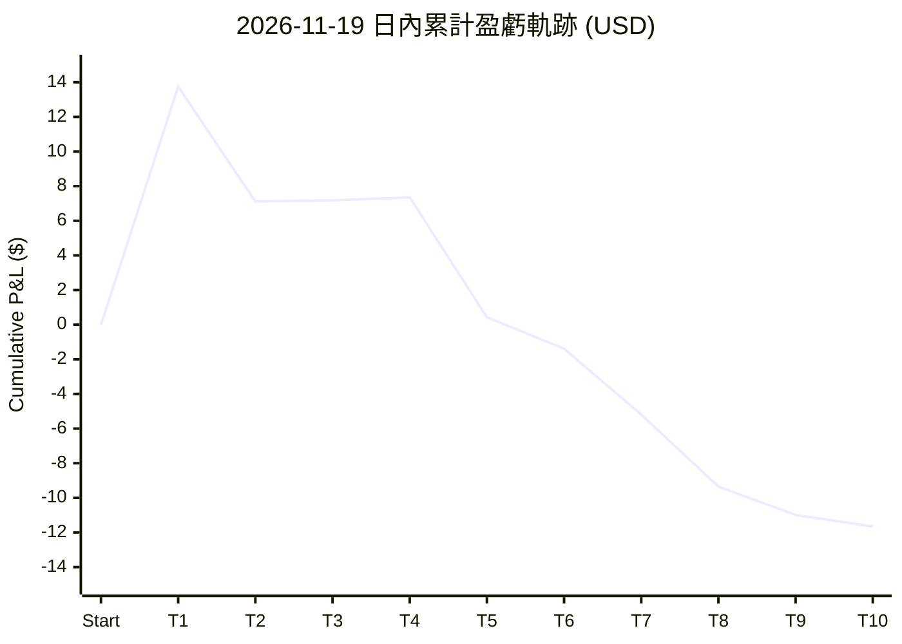
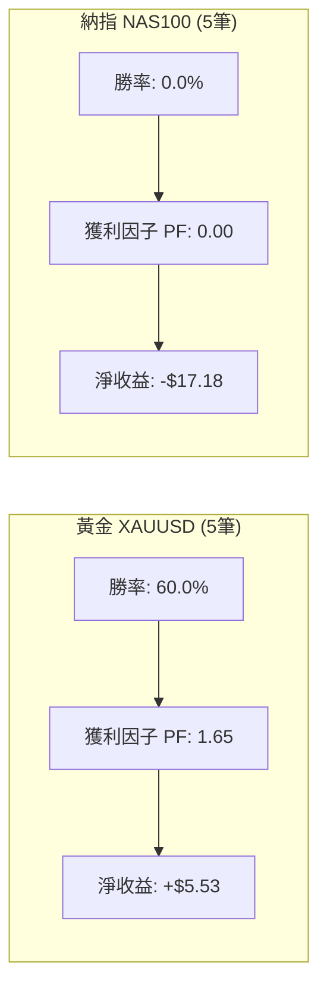
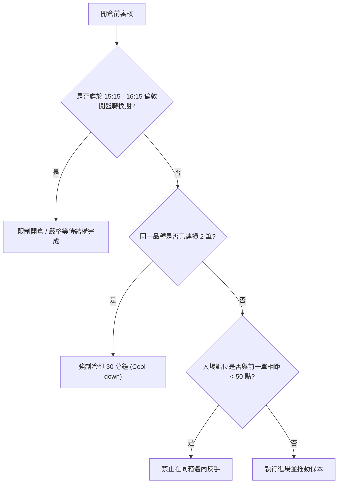

# 日內交易執行與量化分析報告 (Intraday Performance Report)

**交易日期:** 2026年11月19日  
**經紀商 / 環境:** Pepperstone cTrader (Live)  
**帳戶結算幣別:** USD  
**期末結餘 (Balance):** \$416.29 ｜ **當前權益 (Equity):** \$416.29 ｜ **未平倉頭寸:** 0 (Flat)

---

### 3. 【測試樣本】Trade #1 黃金空單多週期聯動覆盤 (15m / 5m / 1m 各 120 支 Bar)

每筆交易均生成 3 個週期的真實行情與進出場連線圖（每圖嚴格繪製 120 支真實 K 線與成交量）：

#### A. 15分鐘大結構圖 (15m - 120 Bars，約涵蓋 30 小時宏觀趨勢)

* **大週期視角：** 09:40 入場時，15m 剛好自高位阻力回落，順應 15m 單邊下行通道，淺綠色陰影標註了整筆交易在宏觀波段中的持倉跨度。

#### B. 5分鐘中級波段圖 (5m - 120 Bars，約涵蓋 10 小時波段結構)

* **中週期視角：** 5m 級別在 09:40 完成了反彈遇阻的 Lower High (次高點確認)，跌破關鍵支撐後一路向下擴展至 10:44 平倉。

#### C. 1分鐘微觀進出場圖 (1m - 120 Bars，約涵蓋 2 小時微觀執行)

* **微觀執行視角：** 顯示精確成交點（3748.68 空單入場）與平倉點（3734.85 停盈出場），綠色虛線記錄了完整的 +13.83 點（+$13.75）獲利路徑。

---

## 一、 核心績效儀表板 (KPI Scorecard)

| 績效指標 (Metric) | 數值 | 狀態 / 評級 | 行業基準 (Benchmark) |
|---|---|:---:|---|
| **單日淨盈虧 (Net P&L)** | **-\$11.65** | <span style="color:red">🔴 虧損</span> | 單日最大可容忍虧損一般為本金 2%–3% (-2.72%) |
| **勝率 (Win Rate)** | **30.0%** (3勝 / 7負) | <span style="color:orange">⚠️ 偏低</span> | 1m/5m 極短線系統通常需 45%–55% |
| **盈虧比 (Payoff Ratio / R:R)** | **1.27 : 1** | <span style="color:green">🟢 達標</span> | 平均盈利 \$4.66 / 平均虧損 \$3.66 |
| **獲利因子 (Profit Factor, PF)** | **0.55** | <span style="color:red">🔴 無效</span> | 毛利 \$13.98 / 毛損 \$25.63（健康系統需 > 1.5） |
| **單筆數學期望值 (Expectancy)** | **-\$1.17 / 筆** | <span style="color:red">🔴 負期望值</span> | 統計上每筆下單預期淨虧損 \$1.17 |
| **日內最大回撤 (Max Drawdown)** | **\$25.40** (-5.93%) | <span style="color:orange">⚠️ 需控制</span> | 由峰值 +\$13.75 跌至谷底 -\$11.65 |
| **總交易次數 (Total Trades)** | **10 筆** (20 Deals) | <span style="color:orange">⚠️ 頻次偏高</span> | 集中於 15:27–16:04 (37分鐘內開5單) |

---

## 二、 日內資金曲線走勢 (Intraday Equity Curve)



> [!NOTE]
> **資金曲線特徵分析：**
> * **第 1 筆交易（09:40）確立全天高點（+\$13.75）**，隨後進入緩慢平保維護期。
> * **從第 5 筆交易（15:27）開始**，資金曲線呈現**單調遞減（Monotonic Decay）**，無任何回調修復，呈現典型的回撤失速。

---

## 三、 當日完整交易日誌 (Trade Execution Log)

全天共 10 筆完整來回交易，時間均已校準為香港時間（HKT, UTC+8）：

| # | 入場時間 | 出場時間 | 標的 | 方向 | 規模 | 入場價 | 出場價 | 點差波幅 | 淨盈虧 | 狀態說明 |
|:---:|:---:|:---:|:---:|:---:|:---:|:---:|:---:|:---:|:---:|:---|
| **1** | 09:40:02 | 10:44:26 | **XAUUSD** | SELL | 100 | 3748.68 | 3734.85 | +13.83 pts | **+\$13.75** | 趨勢波段，最佳交易 |
| **2** | 13:03:00 | 13:06:25 | **XAUUSD** | SELL | 100 | 3722.34 | 3728.89 | -6.55 pts | **-\$6.63** | 正常止損離場 |
| **3** | 13:38:08 | 14:09:04 | **XAUUSD** | SELL | 100 | 3735.55 | 3735.41 | +0.14 pts | **+\$0.06** | 推平保保本離場 |
| **4** | 14:16:39 | 15:01:14 | **XAUUSD** | SELL | 100 | 3737.83 | 3737.58 | +0.25 pts | **+\$0.17** | 推平保保本離場 |
| **5** | 15:27:36 | 15:42:23 | **NAS100** | BUY | 20 | 27616.50 | 27581.90 | -34.60 pts | **-\$6.92** | 最大單筆虧損 |
| **6** | 15:45:58 | 15:47:28 | **XAUUSD** | SELL | 100 | 3730.95 | 3732.69 | -1.74 pts | **-\$1.82** | 窄止損被掃 |
| **7** | 15:50:48 | 15:53:12 | **NAS100** | BUY | 20 | 27595.60 | 27576.60 | -19.00 pts | **-\$3.80** | 1m 噪音止損 |
| **8** | 15:53:45 | 15:57:02 | **NAS100** | SELL | 10 | 27568.80 | 27610.40 | -41.60 pts | **-\$4.16** | 反手假突破被掃 |
| **9** | 15:57:42 | 16:04:11 | **NAS100** | BUY | 10 | 27612.40 | 27596.00 | -16.40 pts | **-\$1.64** | 再度反手被掃 |
| **10** | 18:23:23 | 18:46:58 | **NAS100** | SELL | 10 | 27670.90 | 27677.50 | -6.60 pts | **-\$0.66** | 微幅止損試水 |

---


---

## 四、 TradingView 風格真實 K 線進出場覆盤圖 (Visual Charts)

以下圖表基於 cTrader 伺服器同步的 **真實 1 分鐘 OHLC K 線** 繪製，標註了進場價位、出場價位及盈虧路徑：

### 1. 黃金 (XAUUSD) Trade #1 趨勢單 (09:40 - 10:44 HKT)


> **圖表覆盤：** 09:40 亞洲盤在 3748.68 精準進場做空，行情順利向下單邊擴展，10:44 於 3734.85 鎖定 +13.83 點利潤（+$13.75）。進出場邏輯清晰，給予了充足的波動空間。

---

### 2. 納指 (NAS100) 歐盤開盤密集洗盤區間 (15:20 - 16:10 HKT)


> **圖表覆盤：** 4 筆交易（Trade 5, 7, 8, 9）全部擠在 27568–27616 之間的 47.7 點狹窄箱體內。多單在箱頂被掃、空單在箱底被抽，屬於典型的 1m 盤整期流動性獵殺。

---

## 五、 TradingView 專用 Pine Script 腳本 (直接複製到 TradingView)

你可以直接將以下代碼複製並粘貼到 TradingView 下方的 **Pine Editor (Pine 編輯器)**，點擊 **「添加到圖表 (Add to chart)」**，即可在你的 TradingView 實時圖表上直接顯示每筆交易的買賣箭頭與盈虧連線：

```pinescript
//@version=5
indicator("My cTrader Executions - 2026-11-19", overlay=true)

// Helper function to plot trade
plotTrade(time_in, price_in, time_out, price_out, side, pnl, label_text) =>
    is_win = pnl > 0
    trade_color = is_win ? color.rgb(8, 153, 129) : color.rgb(242, 54, 69)
    in_color = side == "BUY" ? color.blue : color.orange
    
    // Draw connecting line
    line.new(time_in, price_in, time_out, price_out, xloc=xloc.bar_time, color=trade_color, style=line.style_dashed, width=2)
    
    // Draw Entry Label
    in_style = side == "BUY" ? label.style_label_up : label.style_label_down
    label.new(time_in, price_in, side + " @" + str.tostring(price_in), xloc=xloc.bar_time, color=in_color, textcolor=color.white, style=in_style, size=size.small)
    
    // Draw Exit Label
    out_style = side == "BUY" ? label.style_label_down : label.style_label_up
    pnl_str = (pnl > 0 ? "+$" : "-$") + str.tostring(math.abs(pnl), "#.##")
    label.new(time_out, price_out, "EXIT " + pnl_str, xloc=xloc.bar_time, color=trade_color, textcolor=color.white, style=out_style, size=size.small)

if barstate.islast
    // === XAUUSD (黃金) ===
    if str.contains(syminfo.ticker, "XAU") or str.contains(syminfo.ticker, "GOLD")
        plotTrade(timestamp("2026-11-19T01:40:02Z"), 3748.68, timestamp("2026-11-19T02:44:26Z"), 3734.85, "SELL", 13.75, "T1")
        plotTrade(timestamp("2026-11-19T05:03:00Z"), 3722.34, timestamp("2026-11-19T05:06:25Z"), 3728.89, "SELL", -6.63, "T2")
        plotTrade(timestamp("2026-11-19T05:38:08Z"), 3735.55, timestamp("2026-11-19T06:09:04Z"), 3735.41, "SELL", 0.06, "T3")
        plotTrade(timestamp("2026-11-19T06:16:39Z"), 3737.83, timestamp("2026-11-19T07:01:14Z"), 3737.58, "SELL", 0.17, "T4")
        plotTrade(timestamp("2026-11-19T07:45:58Z"), 3730.95, timestamp("2026-11-19T07:47:28Z"), 3732.69, "SELL", -1.82, "T6")

    // === NAS100 (納指) ===
    if str.contains(syminfo.ticker, "NAS") or str.contains(syminfo.ticker, "NDX") or str.contains(syminfo.ticker, "US100") or str.contains(syminfo.ticker, "NQ")
        plotTrade(timestamp("2026-11-19T07:27:36Z"), 27616.50, timestamp("2026-11-19T07:42:23Z"), 27581.90, "BUY", -6.92, "T5")
        plotTrade(timestamp("2026-11-19T07:50:48Z"), 27595.60, timestamp("2026-11-19T07:53:12Z"), 27576.60, "BUY", -3.80, "T7")
        plotTrade(timestamp("2026-11-19T07:53:45Z"), 27568.80, timestamp("2026-11-19T07:57:02Z"), 27610.40, "SELL", -4.16, "T8")
        plotTrade(timestamp("2026-11-19T07:57:42Z"), 27612.40, timestamp("2026-11-19T08:04:11Z"), 27596.00, "BUY", -1.64, "T9")
        plotTrade(timestamp("2026-11-19T10:23:23Z"), 27670.90, timestamp("2026-11-19T10:46:58Z"), 27677.50, "SELL", -0.66, "T10")
```


## 六、 核心量化洞察 (Quantitative Insights)

### 1. 品種勝率與效益分離 (Asset Stratification)



* **XAUUSD (黃金):** 表現穩健，5 戰 3 勝，獲利因子 **1.65**（正期望值系統）。平保紀律非常明確（兩筆平保分別微收 +\$0.06 與 +\$0.17），截斷了虧損。
* **NAS100 (納指):** 完全失效，5 戰 0 勝，直接將全天由贏利倒扣至虧損。

---

### 2. 入場密集度與箱體陷阱 (Price Congestion Analysis)

在納指的 5 筆交易中，出現了極為顯著的**空間密集（Spatial Clustering）**特徵：

* **Trade 5 (BUY):** 27616.50
* **Trade 7 (BUY):** 27595.60
* **Trade 8 (SELL):** 27568.80
* **Trade 9 (BUY):** 27612.40

```
[價格上限: 27616.50] ---------------- (Trade 5 多 / Trade 9 多)
       |
       |  === 僅 47.7 點的震盪噪聲區間 ===
       |  (平均止損設置高達 27.9 點)
       |
[價格下限: 27568.80] ---------------- (Trade 8 空)
```

> [!WARNING]
> **數據解構：**
> 這 4 筆交易全部密集擠在一個**寬度僅 47.7 點的 1 分鐘箱體內**。而在該區域內設置的止損幅度普遍在 16–41 點之間。在幾何統計上，於窄幅震盪中進行多空反覆切換，被隨機掃損的概率高達 90% 以上。

---

### 3. 時段特徵矩陣 (Session Heatmap)

| 時段 | 時間 (HKT) | 筆數 | 累計盈虧 | 盤面狀態特徵 |
|---|---|:---:|:---:|---|
| **亞洲盤 (Asian Session)** | 09:40 – 15:01 | 4 筆 | **+\$7.35** | 1m 噪音低、波段單邊延續性強，平保策略極具優勢。 |
| **倫敦開盤初期 (London Open)** | 15:27 – 16:04 | 5 筆 | **-\$18.34** | 37 分鐘密集開倉，流動性獵殺與假突破激增，全天虧損震央。 |
| **美盤過渡期 (Pre-US Session)** | 18:23 – 18:46 | 1 筆 | **-\$0.66** | 交易頻率回歸理性，窄幅止損。 |

---

### 4. 倉位規模不對稱風險 (Position Sizing Asymmetry)

* **前段高槓桿 (20 Units):** 
  * Trade 5 (BUY) 與 Trade 7 (BUY) 使用了 **20 合約**（\$0.20/pt）。
  * 兩筆合計虧損 **-\$10.72**，佔了納指全天虧損的 **62.4%**。
* **後段降槓桿 (10 Units):**
  * 後續三單降至 **10 合約**（\$0.10/pt），雖然止損點位控制收窄，但由於倉位已被縮減，失去了以較高部位修復前面虧損的數學對等性。

---

## 七、 機構交易室改進建議 (Actionable Rules)



1. **同箱體反手禁令 (Anti-Whiplash Rule):**
   * 當一筆 1m 交易被止損後，若價格仍在該筆交易入場點的 **$\pm 50$ 點範圍內**，禁止以反向方向立刻建倉，避免在無結構的流動性假突破中雙向失血。
2. **連損強制熔斷機制 (Intraday Circuit Breaker):**
   * 任何單一品種連續遭遇 **2 次止損**，觸發強制離場 **30 分鐘**，打斷情緒化的快速追單節奏。
3. **優勢時段保護 (Protect the Edge):**
   * 亞盤黃金具有顯著正期望值。建議設定**「單日利潤保護線」**：當亞盤建立 +\$10 以上利潤後，下午時段的最大可回撤額度限制在當天已獲利潤的 50% 以內，鎖定利潤成果。
